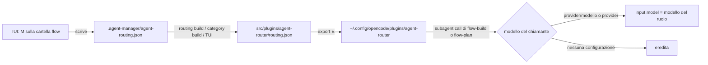

# Archetipi e configurazioni modelli

Guida per chi lavora su questa repository, persone o agenti: come funziona il modello unico per famiglie di agenti, dove si configura e come comportarsi. Per il resto della repository vale `AGENTS.md`.

## 1. Il modello in breve

Un **archetipo** è una famiglia di agenti che lavorano insieme. Oggi ce n'è uno: `flow`. In un secondo passo si aggiungerà `pipeline`, vedi §7.

Ogni archetipo ha tre parti:

| Parte | Cos'è | Dove si gestisce |
|---|---|---|
| **Agenti canonici** | `src/agents/<id>-*.md`. Si installano una sola volta, senza copie per provider o famiglia. | file in `src/`, TUI (`M`, `C`, `P`, `T` sui singoli agenti) |
| **Risorse** | skill, tool, plugin, comandi distribuiti con l'archetipo | TUI `U` (Resource Manager) → `.agent-manager/companion-links.json` e `.agent-manager/categories/<id>.json` |
| **Configurazioni modelli** | "se build o plan gira su X, i subagent che chiama usano questi modelli" | TUI `M` sulla **cartella** dell'archetipo → `.agent-manager/agent-routing.json` |

L'**agente di riferimento** è quello da cui si parte in OpenCode: per `flow` è `flow-build`. Gli altri primari dell'archetipo sono modalità della stessa conversazione: per `flow` c'è `flow-plan`, la plan mode in sola lettura. Si entra in tre modi:

- Shift+Tab;
- `/flow-plan <richiesta>`;
- `flow-build` la propone da solo con il tool `flow_plan_enter`, e l'utente conferma.

Il piano finisce con `flow_plan_exit`, che chiede all'utente di approvarlo e, se approvato, riporta la conversazione su `flow-build`. Se l'utente rifiuta scrivendo un messaggio, il messaggio torna al pianificatore. Tutto questo lo fa il plugin `flow-mode`.

Build e plan sono i **chiamanti**: chi dei due delega a un subagent sceglie la configurazione in base al modello su cui gira in quel momento. Possono anche girare su modelli diversi. I subagent sono gli "agenti collegati" di una configurazione.

`flow-plan` non è più nascosto (`hidden`): OpenCode 2.1.3 non gestisce un primario nascosto come agente corrente, e così Shift+Tab non riportava a build.

Non esistono più famiglie timbrate per provider: niente `hybrid-flow`, `go-flow`, `flow-profiles.json`, `flow apply` e simili. Erano due sistemi in parallelo e sono stati rimossi apposta. Non reintrodurli.

## 2. Una configurazione

```json
"flow": {
  "configs": {
    "mistral":            { "explore": "mistral/deepseek-v4-1-flash-1017#high", "review": "mistral/deepseek-v4-1-flash-1017#high" },
    "mistral/zai-glm-5-3": { "review": "mistral/mistral-large-4#high" }
  }
}
```

- **Trigger** (la chiave): il provider (`mistral`, cioè qualsiasi modello di quel provider) o il modello esatto (`mistral/zai-glm-5-3`) su cui gira il primario che chiama, `flow-build` o `flow-plan`. **Il modello esatto vince** sul provider. La variante (`#high`) del chiamante non conta per la scelta.
- **Valore**: per ogni subagent, `provider/modello#variante` oppure `inherit`. Un ruolo assente eredita.
- **Nessuna configurazione corrispondente**: tutti i subagent ereditano il modello del chiamante, che è il comportamento normale di OpenCode.
- **Agenti fissi**: un subagent canonico con `model` nel frontmatter (impostato con `M` sull'agente) resta su quel modello. Le configurazioni lo saltano e il TUI lo mostra come "Fixed". È il caso tipico di `flow-eye` su un modello vision.
- **Modello iniziale dei primari**: il `model` nel frontmatter di `flow-build` o `flow-plan`, impostato con `M` sull'agente, è solo il modello con cui parte in OpenCode. L'utente può cambiarlo e le configurazioni lo seguono.

## 3. Cosa succede a runtime



Il plugin `agent-router` (`src/plugins/agent-router/index.ts`, logica pura in `src/tools/_agent_router.js`):

1. su `model.request` ricorda agente e modello di ogni sessione, ignorando gli agenti interni title, summary e compaction;
2. su `tool.execute.before` del tool `subagent` (o del vecchio `task`), se il chiamante è un agente canonico di un archetipo, imposta `input.model` in base al modello con cui quel chiamante ha appena parlato col provider.

OpenCode sceglie il modello del subagent come `input.model ?? agent.model ?? modello della sessione padre`. L'ordine effettivo quindi è:

1. un modello passato esplicitamente dal chiamante;
2. l'agente fisso;
3. la configurazione;
4. l'eredità.

Il plugin rilegge `routing.json` a ogni chiamata, quindi non serve riavviare OpenCode. Se il file è rotto o manca, il plugin non fa niente. Interruttori: `OPENCODE_AGENT_ROUTER=off` lo spegne, `OPENCODE_AGENT_ROUTING=<path>` gli fa leggere un altro file.

## 4. Come si usa

**Nel TUI di manage-agents** (il modo normale):

1. Cursore sulla cartella `flow`, nessuna selezione, poi `M`: si apre l'elenco delle configurazioni.
2. `Invio` su "+ New configuration" o su una configurazione esistente, oppure `D` due volte per eliminarla.
   Una nuova configurazione parte dalla scelta del trigger.
3. L'editor funziona come la lista agenti:
   - `SPACE` seleziona un subagent e `A` li seleziona tutti;
   - `M` o `Invio` apre il selettore modelli per la selezione, o per la riga sotto il cursore, con in cima la voce "↺ inherit";
   - `Invio` sulla prima riga ("When build/plan runs on") cambia il trigger; espandendo un provider compare la voce "★ any \<provider\> model";
   - `Tab` o le frecce `←/→` cambiano la variante;
   - `Backspace` riporta a inherit.
   - Il selettore si apre con la cartella del provider del modello attuale già aperta; le altre cartelle sono chiuse e si aprono con `→` o `Invio`.
   - Nel selettore basta scrivere per filtrare: ogni parola deve comparire in `provider/modello` e i provider con risultati si mostrano aperti. `Esc` svuota la ricerca.
4. Ogni modifica si salva subito, come nella lista agenti: valida, scrive `agent-routing.json`, rigenera `routing.json` e, con auto-commit attivo, committa.
5. `E` sulla cartella `flow` installa in OpenCode.

**Da CLI** (per script e agenti):

| Obiettivo | Comando |
|---|---|
| Vedere tutto | `node manage-agents/manage-agents.mjs routing show` |
| Salvare una configurazione (sostituisce quella esistente) | `… routing set flow mistral explore=mistral/deepseek-v4-1-flash-1017#high review=mistral/deepseek-v4-1-flash-1017#high` |
| Eliminarla | `… routing unset flow mistral` |
| Rigenerare o verificare `routing.json` | `… routing build` / `… routing check` |

I nomi esatti dei modelli si trovano con `opencode models`.

## 5. Regole per gli agenti che lavorano qui

- **La fonte è il TUI o la CLI.** Puoi modificare `.agent-manager/agent-routing.json` a mano, è un normale archivio JSON. Dopo però esegui sempre `routing build` (o `category build --all`) e `routing check`.
- **Non modificare mai `src/plugins/agent-router/routing.json`**: è generato, e `category check --all` fallisce se non corrisponde alla configurazione.
- **Non mettere `model` negli agenti canonici di un archetipo** per "configurarli": li rende fissi e le configurazioni smettono di valere. Si fa solo quando l'utente vuole davvero un agente fisso, per esempio il modello vision di `flow-eye`.
- **Non creare copie per provider** degli agenti (bundle timbrati) per flow: è la strada abbandonata.
- **Non proporre di testa tua cambi di modello, temperatura o modello per ruolo** durante le review delle pipeline: decide l'utente.
- **Risorse di un archetipo** (skill, tool, plugin): si aggiungono con il Resource Manager (`U`), oppure in `.agent-manager/companion-links.json` e nel manifest `.agent-manager/categories/<id>.json`. Poi `category build --all`. Un plugin che importa file da `src/tools/` va elencato anche nel manifest.
- **Prima di chiudere**: `npm --prefix manage-agents run validate`.
- **Verifica sul campo.** Dopo una sessione reale di OpenCode, controlla su che modello sono partiti i subagent con una query in sola lettura sul database di OpenCode:

  ```
  sqlite3 -readonly "file:$HOME/.local/share/opencode/opencode.db?mode=ro" \
    "select agent, model, datetime(time_created/1000,'unixepoch','localtime') from session_v2 order by time_created desc limit 10;"
  ```

## 6. Aggiungere un archetipo

1. Gli agenti canonici devono chiamarsi `<id>-<ruolo>.md` in `src/agents/`. I subagent hanno `mode: subagent`.
2. Aggiungi `<id>: { reference: "<ruolo di riferimento>" }` in `ARCHETYPES` di `manage-agents/src/utils/agentRouting.ts`.
3. L'archetipo deve essere distribuito come agenti canonici, cioè una categoria con manifest V2 che includa `src/plugins/agent-router` e `src/tools/_agent_router.js`, più la voce `plugins/agent-router` in `companion-links.json`.
4. Aggiungi i test in `manage-agents/src/utils/agentRouting.test.ts`, poi esegui la validazione.

## 7. Stato e prossimi passi

- **Fatto, passo 1:** `flow` usa il modello unico. I bundle `*-flow`, `flow-profiles.json` e i comandi `manage-agents flow …` sono stati rimossi.
- **Da fare, passo 2:** migrare `pipeline`. Si parte solo dopo che flow è stato verificato in una sessione reale.
  - Gli agenti canonici `pipeline-*` hanno `pipeline-orchestrator` come riferimento e sostituiscono i bundle `*-pipeline` e `pipeline-profiles.json`.
  - Punti delicati: i permessi `task` degli agenti sono legati ai nomi timbrati; ci sono i profili bash; i bridge Claude Code e Codex oggi partono dai bundle timbrati.
- **Bridge Claude Code e Codex:** non usano le configurazioni. Traducono i modelli in alias Claude (`sonnet`, `opus`…) tramite `.agent-manager/translation-config.json`, perché non possono far girare i modelli dei provider OpenCode.
