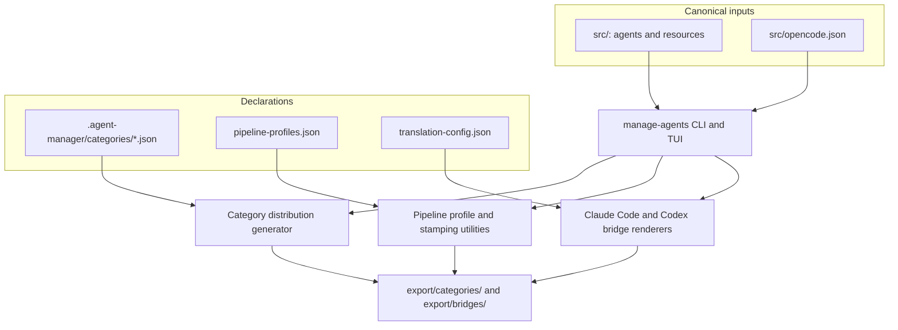
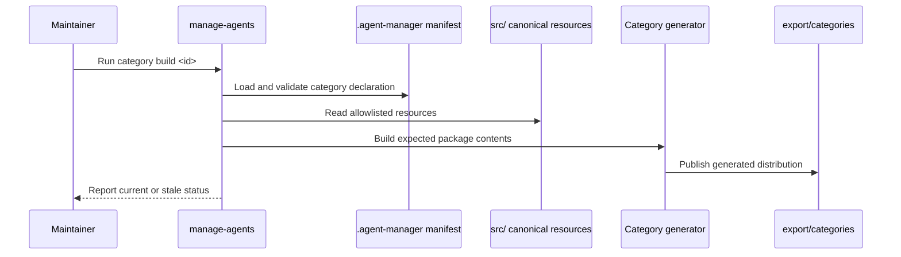

# Architecture

## Overview

The repository separates authored material from configuration and generated output. `src/` holds the canonical catalog and OpenCode blueprint; `.agent-manager/` declares category allowlists, pipeline model profiles, companion-resource links, and translation settings, as detailed in [Workspace and Distribution Configuration](./config/workspace-and-distribution.md). The [Agent Manager](./modules/agent-manager.md) reads these inputs and maintains generated distributions and bridges in `export/`.

## Component Diagram

The manager is the entry point for interactive and command-line operations; focused utilities interpret the relevant declarations and write the corresponding generated output. The [custom tools and plugins](./modules/tools-and-plugins.md) provide additional document, slide, and pipeline operations alongside these generation flows.

## Data Flow

Category manifests define explicit sources, destination paths, content policies, and any generated configuration. The generator validates manifest structure and resource paths, produces package metadata, and can compare the output with expected contents through the read-only check operation.

## Key Design Decisions

### Canonical inputs are separate from generated distributions

- **Context**: Category distributions are projections of selected canonical resources, and provider pipelines are stamped from the base pipeline.
- **Decision**: Author and configure in `src/` and `.agent-manager/`; generate distributions and bridges into `export/`.
- **Consequences**: Generated folders are reproducible outputs; changes should be made in their declared sources and regenerated.

### Category membership is manifest-driven

- **Context**: Category packages may include selected agents and their supporting commands, skills, or tools.
- **Decision**: Each category JSON manifest lists its resources and targets explicitly rather than selecting files by filename alone.
- **Consequences**: The build can validate its source/target declarations and provide a deterministic inventory, while membership changes require updating the manifest.
