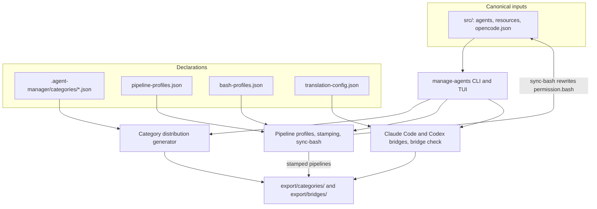
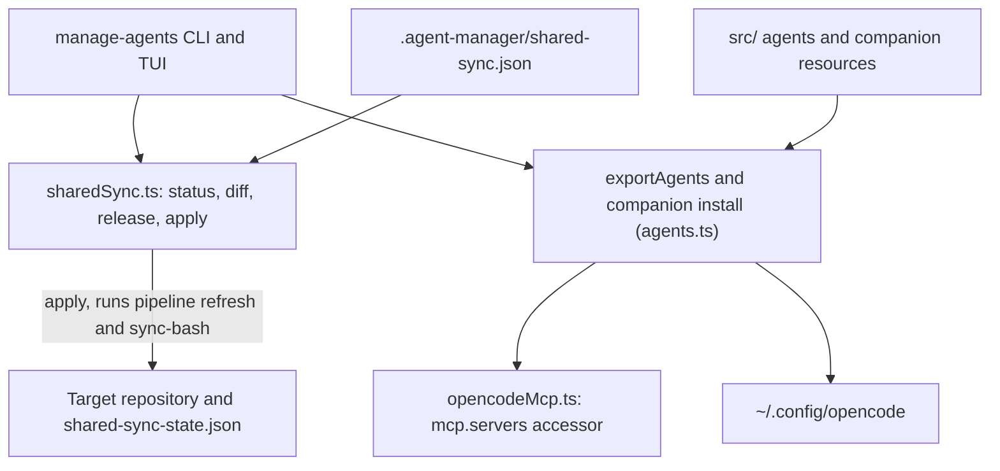
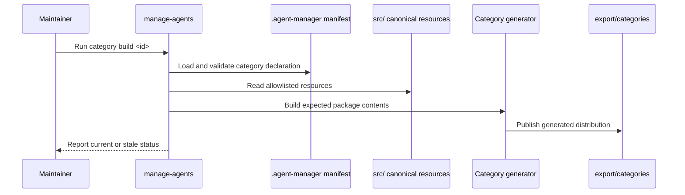
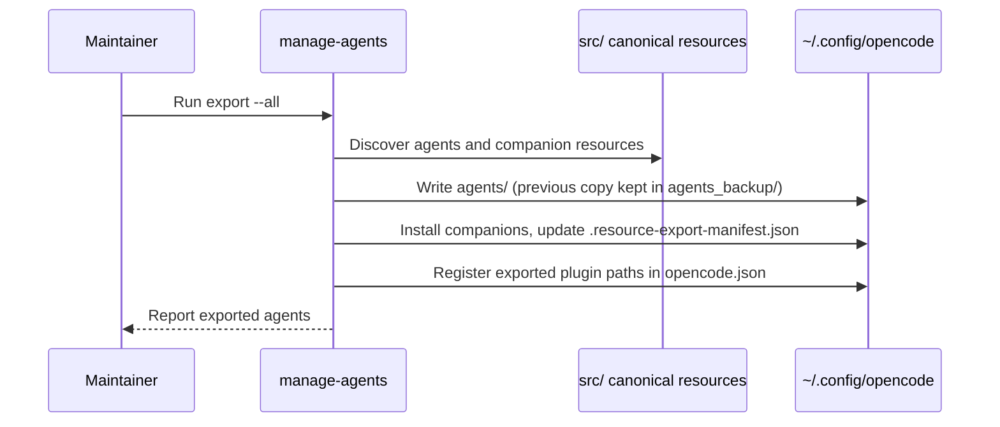

# Architecture

## Overview

The repository separates authored material from configuration and generated output. `src/` holds the canonical catalog and OpenCode blueprint; `.agent-manager/` declares category allowlists, pipeline model profiles, bash permission profiles, companion-resource links, shared-sync components, and translation settings, as detailed in [Workspace and Distribution Configuration](./config/workspace-and-distribution.md). The [Agent Manager](./modules/agent-manager.md) reads these inputs and maintains generated distributions and bridges in `export/`.

## Component Diagram

Generation flows: canonical inputs and declarations are read by the manager and its focused utilities, which write generated distributions and bridges.

The manager is the entry point for interactive and command-line operations; focused utilities interpret the relevant declarations and write the corresponding generated output. `pipeline sync-bash` rewrites the `permission.bash` block of canonical pipeline agents from `bash-profiles.json`, and `bridge check` regenerates a bridge in a temporary workspace and compares it byte-for-byte with the committed `export/bridges/` output. The [custom tools and plugins](./modules/tools-and-plugins.md) provide additional document, slide, and pipeline operations alongside these generation flows.

Distribution flows: shared components move between repositories, and agents are installed into the OpenCode configuration directory.

`sharedSync.ts` copies only the components declared in `.agent-manager/shared-sync.json` into a target repository, and records installed versions and file hashes in `.agent-manager/shared-sync-state.json`. `export` writes agents into `~/.config/opencode/agents/` and installs companion resources matching each agent's domain under the same subpaths (`tools/`, `commands/`, `skills/`, `plugins/`). `opencodeMcp.ts` is the single accessor for the MCP section of an OpenCode config (V1 flat `mcp` and V2 `mcp.servers`); the export path, the bridges, and the agent catalog all read MCP servers through it.

## Data Flow

Category manifests define explicit sources, destination paths, content policies, and any generated configuration. The generator validates manifest structure and resource paths, produces package metadata, and can compare the output with expected contents through the read-only check operation.

The export flow installs canonical agents into the OpenCode configuration directory, reconciling managed companion resources with a manifest so that resources no longer delivered are removed:

## Key Design Decisions

### Canonical inputs are separate from generated distributions

- **Context**: Category distributions are projections of selected canonical resources, and provider pipelines are stamped from the base pipeline.
- **Decision**: Author and configure in `src/` and `.agent-manager/`; generate distributions and bridges into `export/`.
- **Consequences**: Generated folders are reproducible outputs; changes should be made in their declared sources and regenerated.

### Category membership is manifest-driven

- **Context**: Category packages may include selected agents and their supporting commands, skills, or tools.
- **Decision**: Each category JSON manifest lists its resources and targets explicitly rather than selecting files by filename alone.
- **Consequences**: The build can validate its source/target declarations and provide a deterministic inventory, while membership changes require updating the manifest.

### Shared components are versioned and local overlays are never overwritten

- **Context**: The Agent Manager and the pipeline core are shared between repositories that keep their own profiles, overlays, and configuration.
- **Decision**: `.agent-manager/shared-sync.json` gives each component a semver `version`, `include`/`exclude` globs, and a `localOverlay.neverOverwrite` list; `pipelineCore` also declares a `requiresAgentManager` range. Applying a sync records installed versions and file hashes in `.agent-manager/shared-sync-state.json`, preserves overlay paths instead of writing them, and refuses to overwrite locally modified shared files unless `--force` is passed.
- **Consequences**: Sync copies only declared components, transactionally with rollback on failure. `pipelineCore` is refused unless the effective Agent Manager version satisfies its range. Target-side customizations survive sync.

### Plugins are directories exporting Plugin.define; single-file plugins are unsupported

- **Context**: OpenCode V2 loads plugins as directories and does not discover `tools/*.ts`.
- **Decision**: Each plugin lives in its own directory under `src/plugins/` and exports a default `Plugin.define({ id, setup })`. Tools are registered by domain plugins (`dev-tools`, `pipeline-tools`, `doc-tools`, `slide-tools`) through `ctx.tool.transform` with static imports. A plugin or helper used by more than one workflow (`flow` and `pipeline`) carries no workflow prefix: `dev-tools` (`dev_*` tools), `_repo.js`, `_sessions.js`, `_bash_guard.js`, `_run.js`, `_env.js`, `_serve.js`, `_services.js`.
- **Consequences**: Legacy single-file `plugins/*.js` are not supported by OpenCode V2 and are not discovered by the Resource Manager or export; such files must be migrated to directories or removed manually.
