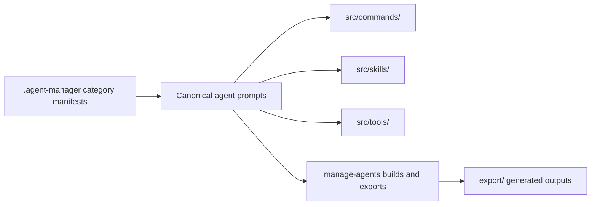

# Agent Catalog

## Purpose

The catalog is the repository's authored collection of OpenCode agent prompts and their supporting [workflow resources](./workflow-resources.md). It includes pipeline roles for delegation and implementation, plus domain-specific agents for wiki authoring, document creation, and slide workflows. Catalog content is maintained in `src/`; category outputs are selected from that source set by manifests.

## Key Files

| File | Role |
|------|------|
| `src/agents/pipeline-orchestrator.md` | Defines a primary coordinator that assesses requests, routes tasks, delegates to specialist agents, and evaluates results. |
| `src/agents/pipeline-executor.md` | Defines a focused implementation subagent with plan-following and scope-discipline instructions. |
| `src/agents/wiki-writer.md` | Defines the wiki page writer and its requirements for source-grounded pages and pass-specific linking. |
| `src/agents/wiki-indexer.md` | Defines the owner of the wiki index, operation log, and glossary. |
| `src/agents/docs-orchestrator.md` | Defines the document workflow, including planning, HTML authoring, and conversion. |
| `src/agents/slides-orchestrator.md` | Defines the slide workflow for authoring and exporting presentations. |
| `src/commands/`, `src/skills/`, `src/tools/`, `src/plugins/` | Supporting workflow resources available alongside agent prompts. |

The catalog also contains other pipeline roles and related agents. The README groups pipeline families around planning, research, execution, testing, review, security, specialist, and post-session tasks.

## Public API

Agent prompts expose role instructions through Markdown files with OpenCode frontmatter. The representative catalog includes:

- **Coordinator**: `pipeline-orchestrator` delegates to allowed pipeline agents and does not implement changes itself.
- **Executor**: `pipeline-executor` applies plan-driven code changes within a defined scope.
- **Domain workflows**: wiki, docs, and slides agents define specialized creation and maintenance processes.
- **Supporting resources**: commands, skills, tools, plugins, and `src/opencode.json` provide workflow and configuration material.

## Dependencies



- Internal resources include prompts, commands, skills, tools, plugins, and the OpenCode configuration blueprint under `src/`.
- Category manifests in `.agent-manager/categories/` select resources for generated distributions; the [Agent Manager](./agent-manager.md) builds those outputs under `export/`.

## Usage Example

Build and then check all configured category distributions from the repository root:

```bash
node manage-agents/manage-agents.mjs --no-auto-commit category build --all
node manage-agents/manage-agents.mjs --no-auto-commit category check --all
```
