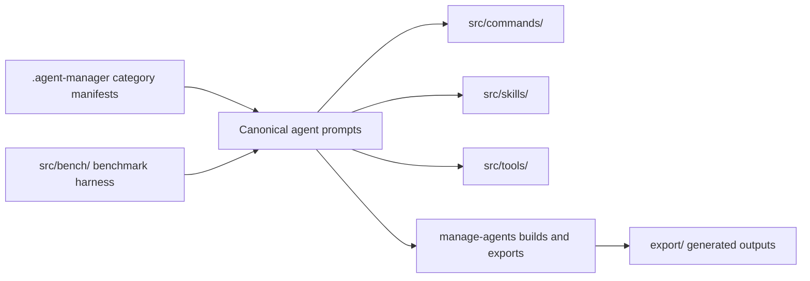

# Agent Catalog

## Purpose

The catalog is the repository's authored collection of OpenCode agent prompts and their supporting [workflow resources](./workflow-resources.md). It includes pipeline roles for delegation and implementation, plus domain-specific agents for wiki authoring, document creation, and slide workflows. Catalog content is maintained in `src/`; category outputs are selected from that source set by manifests.

## Key Files

| File | Role |
|------|------|
| `src/agents/pipeline-orchestrator.md` | Defines a primary coordinator that assesses work size, routes to the smallest effective lane, delegates to specialist agents, and evaluates results. It never writes code directly. |
| `src/agents/pipeline-executor.md` | Defines a focused implementation subagent that applies small, plan-driven changes without expanding scope. |
| `src/agents/pipeline-planner.md` | Defines a planner that creates minimal implementation plans once repository context is available. It does not edit files. |
| `src/agents/pipeline-reasoner.md` | Defines a deep-reasoning agent for complex bugs, algorithms, architecture, performance, security, concurrency, and root-cause analysis. |
| `src/agents/pipeline-critic.md` | Defines the final validation agent for complex work, checking that the result satisfies the original request without overengineering. |
| `src/agents/pipeline-fast_lane.md` | Defines a low-cost agent for trivial or small, clear, low-risk coding tasks and obvious local bug fixes. |
| `src/agents/wiki-writer.md` | Defines the wiki page writer and its requirements for source-grounded pages and pass-specific linking. |
| `src/agents/wiki-indexer.md` | Defines the owner of the wiki index, operation log, and glossary. |
| `src/agents/wiki-analyzer.md` | Defines the read-only analyzer that inspects codebase structure for wiki generation. |
| `src/agents/wiki-orchestrator.md` | Defines the wiki generation and update coordinator, which decides the flow and delegates to writer and indexer subagents. |
| `src/agents/wiki-updater.md` | Defines the agent that maps git-diff source changes to the wiki pages they affect. |
| `src/agents/docs-orchestrator.md` | Defines the document workflow, including planning, HTML authoring, and conversion. |
| `src/agents/slides-orchestrator.md` | Defines the slide workflow for authoring and exporting presentations. |
| `src/agents/storybook-docs_format.md` | Defines an agent that creates and formats Storybook CSF3 stories and autodocs for UI components. It is not listed in any category manifest. |
| `src/commands/`, `src/skills/`, `src/tools/`, `src/plugins/` | Supporting workflow resources available alongside agent prompts. |

The catalog contains 37 agent files in `src/agents/`. Besides the key files above, it includes 21 `pipeline-*` roles, `chrome-devtools.md`, three `docs-*` agents, six `slides-*` agents, and the remaining wiki agents.

### Pipeline Roles

The `pipeline-*` files are the shared base roles. The README describes four pipeline families (free, Go, hybrid, and Mistral) that are stamped from these sources as `*-pipeline` profiles.

| Role | Responsibility (from agent description) |
|------|-----------------------------------------|
| `pipeline-orchestrator` | Assesses work size, routes to the smallest lane, delegates, and evaluates results. |
| `pipeline-explorer` | Fast read-only exploration that locates relevant files, patterns, tests, and configs. |
| `pipeline-researcher` | External research outside the repository (web, registries, changelogs, advisories). |
| `pipeline-docs_grounding` | Fetches and summarizes external library documentation. Does not edit files. |
| `pipeline-planner` | Creates minimal implementation plans. Does not edit files. |
| `pipeline-reasoner` | Deep reasoning for complex bugs, architecture, performance, security, and concurrency. |
| `pipeline-fast_lane` | Fast, low-cost handling of trivial or small, low-risk tasks. |
| `pipeline-executor` | Applies small, plan-driven code changes within scope. |
| `pipeline-refactorer` | Behavior-preserving simplification and cleanup. |
| `pipeline-tester` | Designs, writes, and evaluates tests for changed behavior. |
| `pipeline-code_reviewer` | Reviews changes for correctness, simplicity, maintainability, regressions, and security. Does not implement by default. |
| `pipeline-critic` | Final validation against the original request without overengineering. |
| `pipeline-security_auditor` | Reviews diffs for OWASP Top 10 and CWE patterns. Does not edit files. |
| `pipeline-frontend_specialist` | Read-only frontend advisor used before implementation to identify UI conventions and reusable components. |
| `pipeline-chrome_devtools` | Frontend debugging and visual validation via Chrome DevTools. |
| `pipeline-swift_specialist` | Apple/Swift specialist that validates plans and code against Apple conventions. Does not edit files. |
| `pipeline-kotlin_specialist` | Kotlin/Android specialist that validates plans and code against Android conventions. Does not edit files. |
| `pipeline-multimodal` | Handles visual inputs such as screenshots, mockups, and diagrams before planning or implementation. |
| `pipeline-ops` | Operational diagnostics and runtime verification via bash. Cannot modify repository files. |
| `pipeline-hitl` | Human-in-the-loop checkpoint that explains changes in plain language. Informational and non-blocking. |
| `pipeline-post_session` | Creates final or checkpoint commits for completed pipeline work. |

## Public API

Agent prompts expose role instructions through Markdown files with OpenCode frontmatter. The representative catalog includes:

- **Coordinator**: `pipeline-orchestrator` delegates to allowed pipeline agents and does not implement changes itself.
- **Executor**: `pipeline-executor` applies plan-driven code changes within a defined scope.
- **Domain workflows**: wiki, docs, slides, and Storybook agents define specialized creation and maintenance processes. The wiki set is analyzer, orchestrator, writer, updater, and indexer.
- **Supporting resources**: commands, skills, tools, plugins, and `src/opencode.json` provide workflow and configuration material.

## Distribution

Category manifests in `.agent-manager/categories/` select which agents ship in each generated bundle:

| Category | Agents included |
|----------|-----------------|
| `wiki` | `wiki-analyzer`, `wiki-indexer`, `wiki-orchestrator`, `wiki-updater`, `wiki-writer` (plus the wiki command, three wiki skills, and `src/AGENTS.md`) |
| `docs` | `docs-orchestrator`, `docs-planner`, `docs-html_writer` |
| `slides` | `slides-orchestrator`, `slides-planner`, `slides-html_writer`, `slides-template_planner`, `slides-template_writer`, `slides-composition_resolver` |

Pipeline roles are not in these manifests. They are distributed through the stamped `*-pipeline` profiles. `storybook-docs_format` is in `src/agents/` but not in any category manifest.

### Benchmark Harness

`src/bench/` contains an offline harness that measures a `*-pipeline-*` agent family on small local tasks built from `fixtures/`. It runs `opencode run --agent <family>-pipeline-orchestrator` in a throwaway git repository and compares results across runs. See `src/bench/README.md` for usage and the task list.

## Dependencies



- Internal resources include prompts, commands, skills, tools, plugins, and the OpenCode configuration blueprint under `src/`.
- Category manifests in `.agent-manager/categories/` select resources for generated distributions; the [Agent Manager](./agent-manager.md) builds those outputs under `export/`.

## Usage Example

Build and then check all configured category distributions from the repository root:

```bash
node manage-agents/manage-agents.mjs --no-auto-commit category build --all
node manage-agents/manage-agents.mjs --no-auto-commit category check --all
```
