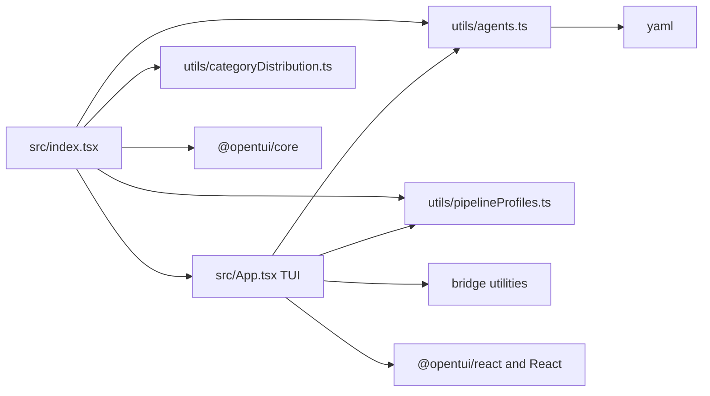

# Agent Manager

## Purpose

The manager is a standalone Node.js/Bun CLI and interactive terminal application for working with the repository's agent catalog. It supports agent maintenance and import/export, category build/check/package operations, pipeline profiles, and Claude Code/Codex bridge generation.

## Key Files

| File | Role |
|------|------|
| `manage-agents/src/index.tsx` | CLI entry point: resolves a workspace, dispatches commands, or initializes the OpenTUI/React application. |
| `manage-agents/src/App.tsx` | Implements the interactive TUI, loading agent data and coordinating user actions. |
| `manage-agents/src/utils/agents.ts` | Parses and updates agent files and implements resource discovery, permission handling, and import/export operations. |
| `manage-agents/src/utils/categoryDistribution.ts` | Loads and validates category manifests; builds, checks, and packages category distributions. |
| `manage-agents/src/utils/pipelineProfiles.ts` | Loads pipeline profiles and applies, syncs, refreshes, forks, or removes stamped pipeline categories. |
| `manage-agents/package.json` | Declares runtime requirements, package dependencies, and test/typecheck/build/validate scripts. |
| `manage-agents/README.md` | Documents installation, CLI commands, TUI keymap, workflows, and development checks. |

## Public API

The package command entry is `manage-agents/manage-agents.mjs`. The principal CLI command groups are:

- `category`: list, explain, build, check/status, package, and recover category distributions.
- `pipeline`: list or show profiles, apply or sync profiles, refresh stamped pipelines, and delete stamped outputs.
- `bridge`: generate a Claude Code or Codex translation layer.
- `create`, `lint`, `fix-names`, `audit`, `import`, `export`, and `tune`: create and maintain agents and their settings.

Running without a subcommand starts the TUI. The entry point also accepts direct `--help` and routes command execution to focused handlers and utility functions.

## Dependencies



- Internal: manager entry point, TUI, agent utilities, category distribution utilities, pipeline profile utilities, and bridge utilities.
- External: `@opentui/core`, `@opentui/react`, `react`, `react-dom`, `react-reconciler`, and `yaml`; build tooling includes esbuild, TypeScript, and tsx. Distribution settings are described in [Workspace and Distribution Configuration](../config/workspace-and-distribution.md).

## Usage Example

Install and launch the interactive manager from its package directory:

```bash
cd manage-agents
npm ci
npm start
```

For a non-interactive category check from the repository root:

```bash
node manage-agents/manage-agents.mjs --no-auto-commit category check --all
```
