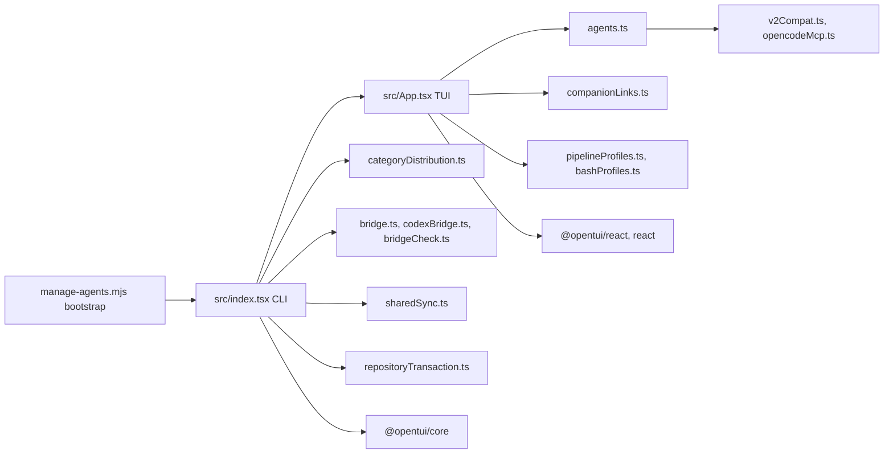

# Agent Manager

## Purpose

The manager is a standalone Node.js/Bun CLI and interactive terminal application (OpenTUI/React) for working with the repository's agent catalog. It covers agent maintenance and naming, category distribution build/check/package, pipeline profiles and the Bash allowlist sync, Claude Code and Codex bridge generation (see [Bridges](bridges.md)), shared-component releases between repositories (`sync`), and installation of agents and companion resources into the OpenCode configuration (`export`).

Repository mutations go through a transaction layer that can auto-commit when enabled; see [Auto-commit and safety](#auto-commit-and-safety).

## Key Files

| File | Role |
|------|------|
| `manage-agents/manage-agents.mjs` | Executable entry (`bin` in `package.json`). On Node it re-execs with `--experimental-ffi`, rebuilds `dist/index.js` when `src/` is newer, then imports the bundle. |
| `manage-agents/src/index.tsx` | CLI dispatch: resolves the workspace, runs the command handlers (`bridge`, `export`, `pipeline`, `category`, `sync`, and others), or starts the TUI when no subcommand is given. |
| `manage-agents/src/App.tsx` | Implements the interactive TUI, loading agent data and coordinating user actions, including the Resource Manager. |
| `manage-agents/src/utils/agents.ts` | Parses and updates agent files; resource discovery, permission handling, OpenCode export (with resource manifest and MCP normalization), and import. |
| `manage-agents/src/utils/categoryDistribution.ts` | Loads and validates category manifests; builds, checks, and packages category distributions. |
| `manage-agents/src/utils/pipelineProfiles.ts` | Loads pipeline profiles and applies, syncs, refreshes, or deletes stamped pipeline categories. |
| `manage-agents/src/utils/bashProfiles.ts` | Loads `.agent-manager/bash-profiles.json`, expands per-role `permission.bash` blocks, reports drift, and rewrites agent bash blocks (`pipeline sync-bash`). |
| `manage-agents/src/utils/bridge.ts` | Claude Code bridge: converts selected agents into a plugin under `export/bridges/claude-code/`. |
| `manage-agents/src/utils/codexBridge.ts` | Codex bridge: converts selected agents into a plugin under `export/bridges/codex/`. |
| `manage-agents/src/utils/bridgeCheck.ts` | `checkBridge`: regenerates a bridge in a temporary tree and compares it with the committed output (`bridge check`). |
| `manage-agents/src/utils/bridgeToolReferences.ts` | Table-driven rewrite of OpenCode tool names in prompt bodies, plus the runtime note for OpenCode-only tools. |
| `manage-agents/src/utils/claudePluginCli.ts` | Wraps the `claude` CLI for `plugin validate` and marketplace/plugin registration. |
| `manage-agents/src/utils/claudeNextSteps.ts` | Builds the manual validate/run lines printed after a Claude bridge. |
| `manage-agents/src/utils/companionLinks.ts` | Reads and writes `.agent-manager/companion-links.json` and syncs plugin entries into category manifests (see [Resource Manager](#resource-manager-and-companion-links)). |
| `manage-agents/src/utils/opencodeMcp.ts` | Single accessor for the MCP section: V1 flat `mcp` with `enabled` versus V2 `mcp.servers` with `disabled`. |
| `manage-agents/src/utils/sharedSync.ts` | Engine for `sync`: reads `.agent-manager/shared-sync.json`, compares components, writes SHA-256 release bundles, and applies files to a target repository. |
| `manage-agents/src/utils/translationConfig.ts` | Loads, normalizes, migrates (V1), and saves `.agent-manager/translation-config.json`; default plugin name is `decent-pipeline`. |
| `manage-agents/src/utils/v2Compat.ts` | Translates agent frontmatter, permissions, and config between OpenCode V1 and V2 formats. |
| `manage-agents/src/utils/repositoryTransaction.ts` | Auto-commit transaction wrapper, `--auto-commit` / `--no-auto-commit` parsing, and commit message constants. |
| `manage-agents/src/utils/pathValidation.ts` | Workspace-containment and symlink-aware path checks (`realpathThroughExistingAncestor`, `assertInsideRealWorkspace`). |
| `manage-agents/src/utils/layout.ts` | TUI panel width and list/inspector split calculations. |
| `manage-agents/src/utils/uiConfig.ts` | Loads and saves `.agent-manager/ui-config.json` (`listShare`) with revision checks and a lock. |
| `manage-agents/src/utils/terminalText.ts` | Terminal-safe text, display-width measurement, and middle ellipsis for the TUI. |
| `manage-agents/src/utils/models.ts` | Parses the `opencode models` catalog (including verbose variant blocks) and validates or suggests model IDs. |
| `manage-agents/package.json` | Declares runtime requirements, dependencies, and the `start`, `build`, `typecheck`, `test`, and `validate` scripts. |
| `manage-agents/README.md` | Documents installation, CLI commands, TUI keymap, workflows, and development checks. |
| `manage-agents/GUIDA.md` | Italian practical guide: recipes, backup and safety notes, and the handoff for maintaining the pipeline. |

## Public API

### Entry and global options

`manage-agents/manage-agents.mjs` is the package command entry. Running it without a subcommand starts the TUI. `--help` / `-h` as the first argument prints the command list.

`--auto-commit` and `--no-auto-commit` are global: they must precede the subcommand (for example `node manage-agents/manage-agents.mjs --no-auto-commit category build wiki`). They override the `AGENT_MANAGER_AUTO_COMMIT` environment variable.

### Commands

- `category`: `list`, `explain`, `build`, `check` / `status`, `package`, and `recover`. `build` and `check` accept an id or `--all`. `--all` also covers stamped `*-pipeline` bundles. `topic-export` is a deprecated alias that forwards to `category build|check wiki`.
- `pipeline`: `list`, `show <profile>`, `apply <profile>`, `sync <profile>` / `sync --all`, `refresh`, `sync-bash [--dry-run]`, and `delete <name> [--also-installed]`. `sync-bash` rewrites only the `permission.bash` blocks of `src/agents/pipeline-*.md` from `.agent-manager/bash-profiles.json`; it prints a reminder to run `category build --all` when files changed.
- `bridge [--category <name>] [--target claude|codex]`: generates a Claude Code or Codex translation layer. The default plugin name is `decent-pipeline`; the default output is `export/bridges/<claude-code|codex>/<plugin-name>/`. Options (`--name`, `--prefix`, `--source-dir`, `--config`, `--model`, `--map-all`, `--no-validate`, `--no-register`, `--marketplace-name`, `--wizard`) are described in [Bridges](bridges.md).
- `bridge check [--category <name>] [--target claude|codex]`: regenerates every committed bridge in a temporary workspace and compares it byte-exact with `export/bridges/`. It exits with code 1 on drift and never persists the translation config.
- `export [--all|-a] [--yes|-y] [--category|-c <name>] [--profile|-p <name>] [--stack|-s <path>]`: installs agents and companion resources into the OpenCode configuration directory (`$XDG_CONFIG_HOME/opencode/`, or `~/.config/opencode/`); details in the paragraphs below.
- `sync` (alias `shared-sync`): `status` (alias `diff`), `release`, and `apply` (alias `import`) for the `agentManager` and `pipelineCore` components, driven by `.agent-manager/shared-sync.json`. `apply` never creates a Git commit and refreshes stamped pipelines and Bash profiles unless `--no-refresh` is given.
- `create`, `lint`, `fix-names [--dry-run]`, `audit`, `import [--dry-run]`, and `tune`: create and maintain agents, naming and permission audits, OpenCode import, and model parameters (`steps`, `temp`, `variant`).

`export --all --yes` is the non-interactive full install. For a complete export (`--all` without `--category` or `--profile`) the manager also:

- writes the MCP block of the OpenCode `opencode.json` to V2 shape (`mcp.servers`, `disabled`), preserving other top-level keys and server fields;
- merges plugin directories into the OpenCode configuration;
- deletes previously installed managed resources that are no longer delivered, as tracked in `.resource-export-manifest.json`. Partial exports (`--category` or `--profile`) only add to that manifest.

Identical resource files are skipped, so re-running the command writes only what changed.

### Validation scripts

From `manage-agents/package.json`:

| Script | Runs |
|--------|------|
| `start` | `node manage-agents.mjs` (TUI) |
| `typecheck` | `tsc --noEmit` |
| `test` | `typecheck`, then `node --import tsx --test` over `src/utils/*.test.ts` plus the Python-tool, guard, pipeline, and bench tests under `../src/`. |
| `build` | `esbuild` bundle of `src/index.tsx` to `dist/index.js` (`@opentui/core` and `yaml` are external). |
| `validate` | `typecheck`, `test`, `build`, `node manage-agents.mjs --no-auto-commit category build --all`, `category check --all`, and `bridge check`. |

Note: `validate` includes `category build --all`, which rewrites generated bundles under `export/categories/`. The README and GUIDA describe `validate` as read-only; the script is the authoritative description.

## Resource Manager and companion links

In the TUI, the Resource Manager (footer label `U`, handled as `u` in `src/App.tsx`) opens for a focused agent or a category folder. It edits the `plugins`, `commands`, `skills`, and `tools` companion links for a category and the agent's allowlists.

On save, `App.tsx` runs one repository mutation over `.agent-manager/companion-links.json`, the category manifest, and `export/categories/<id>`. It then calls `updateCategoryCompanionLinks` (`src/utils/companionLinks.ts`):

- `companion-links.json` is written with `version: 1` and the normalized links for the category.
- For a category whose `.agent-manager/categories/<id>.json` manifest has `schemaVersion: 2`, the plugin entries (`target` under `plugins/`) are synced into `resources`:
  - Non-plugin resources are left untouched.
  - A plugin entry that already exists with the same `target` keeps its `policy` (for example `"text"`).
  - A newly added plugin entry is created as `kind: "directory"` with `policy: "runtime"` and source `<src>/<plugin>`.
  - Removed plugin entries are dropped from the manifest.
- Category ids must match `^[a-z0-9][a-z0-9_-]*$`; traversal ids such as `../../outside` never touch a manifest.
- Symlinked `.agent-manager`, `.agent-manager/categories`, or manifest paths are rejected. A symlinked `.agent-manager` makes the save fail with "Companion links path must not be a symlink"; a symlinked categories directory or manifest causes the manifest sync to be skipped.

After the manifest sync, the TUI refreshes stamped pipelines when the target is `pipeline` or `*-pipeline`, and calls `buildCategoryDistribution` when the manifest exists, which rebuilds `export/categories/<id>`.

## Bridges

Bridge generation is implemented in `bridge.ts` (Claude Code) and `codexBridge.ts` (Codex), with `bridgeToolReferences.ts` for prompt rewriting and `bridgeCheck.ts` for drift checks. The Claude bridge runs validation and registration after the repository transaction closes, using `claudePluginCli.ts`. The full design, output layout, and translation rules are documented in [Bridges](bridges.md).

## Auto-commit and safety

Auto-commit is off by default. `--auto-commit` or `AGENT_MANAGER_AUTO_COMMIT=1` enables a best-effort local commit for mutations wired to `repositoryTransaction` (for example `tune`, `create`, `import`, single-category `build`, and TUI mutations). It is skipped for CLI and TUI `export`, `category package`, `category recover`, and `category build --all`. `--no-auto-commit` or `AGENT_MANAGER_AUTO_COMMIT=0` disables it. Environment values other than `0` or `1` are rejected.

Path handling uses `pathValidation.ts`: repository-local paths may not contain `..` and symlinked parents or targets are refused. The `export` command writes to the OpenCode configuration directory and keeps backups (`agents_backup/` and `resource_export_backup_<timestamp>_<suffix>/`); see `README.md` and `GUIDA.md` for the backup retention rules.

## Dependencies



- Internal: [Bridges](bridges.md) for the bridge pipeline; [Workspace and Distribution Configuration](../config/workspace-and-distribution.md) for the `.agent-manager/` settings these utilities read.
- External: `@opentui/core` and `@opentui/react` (0.5.7), `react`, `react-dom`, `react-reconciler`, and `yaml` as runtime dependencies. Build and test tooling: `esbuild`, `typescript`, `tsx`, and `@types/node` (dev). The engines field requires Node `>=26.4.0` or Bun `>=1.3.0`.

## Usage Example

Install and launch the interactive manager from its package directory:

```bash
cd manage-agents
npm ci
npm start
```

From the repository root, a read-only category check and the bridge drift check:

```bash
node manage-agents/manage-agents.mjs --no-auto-commit category check --all
node manage-agents/manage-agents.mjs bridge check
```

Preview and then apply the Bash allowlist sync, and install every agent into OpenCode without prompts:

```bash
node manage-agents/manage-agents.mjs --no-auto-commit pipeline sync-bash --dry-run
node manage-agents/manage-agents.mjs --no-auto-commit pipeline sync-bash
node manage-agents/manage-agents.mjs export --all --yes
```
