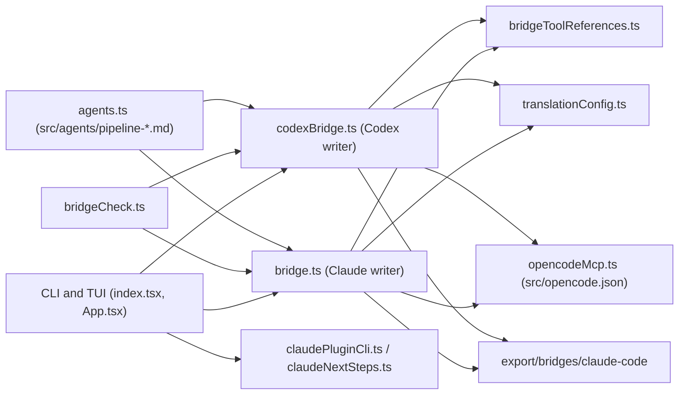

# Bridges

## Purpose

The bridges translate the canonical pipeline agents (`src/agents/pipeline-*.md`), their linked OpenCode commands and companion skills, and the OpenCode MCP/LSP declarations into two distribution formats written under `export/bridges/`:

- **Claude Code plugin** (`bridge.ts`, target `claude`): a plugin directory with a local marketplace manifest, agent prompts, plugin skills, and runtime MCP/LSP configuration.
- **Codex translation layer** (`codexBridge.ts`, target `codex`): a plugin directory with Codex subagent TOML files, per-agent skills, and MCP configuration.

The output directories are generated artifacts. Their README files state that they must not be edited by hand; changes go to the canonical sources or to `.agent-manager/translation-config.json`, followed by regeneration. Model selection is driven by translation tiers and role mappings (see [Translation tiers and model mapping](#translation-tiers-and-model-mapping)). A read-only regeneration check, `bridge check`, detects drift between committed output and the current sources (see [Bridge check](#bridge-check)).

The bridge code lives in the `manage-agents` tool, which also owns the agent catalog and export flows. See [Agent Manager](agent-manager.md) and [Agent Catalog](agent-catalog.md). Where the generated output sits in the wider distribution model is described in [Workspace and Distribution](../config/workspace-and-distribution.md), and the overall system is in [Architecture](../architecture.md).

## Responsibilities

- Discover agents for a category and resolve their target model (`resolveModelTarget` in `translationConfig.ts`).
- Convert agent frontmatter and bodies: normalize names, rewrite agent references, translate tool names, and build tool allowlists (Claude) or sandbox modes (Codex).
- Translate linked OpenCode commands into Claude plugin skills, and copy linked companion skills (Claude only).
- Translate OpenCode MCP declarations (`src/opencode.json`, fallback `general/opencode.json`) into `.mcp.json` for each target, including remote `url` servers.
- Translate OpenCode LSP declarations into Claude `.lsp.json`.
- Generate the Claude marketplace and plugin manifests and register/validate the plugin through the `claude` CLI (TUI and CLI flow).
- Prune stale generated artifacts and refuse writes that escape the workspace through symlinks.
- Validate and compare generated output against committed output (`bridge check`).

## Key Files

| File | Role |
|------|------|
| `manage-agents/src/utils/bridge.ts` | Claude Code writer: `bridgeToClaudeCode` (entry point), `buildClaudeCodePlugin`, `convertAgent`, `writeClaudeCodePlugin`, MCP/LSP translation, command-to-skill conversion, README generation |
| `manage-agents/src/utils/codexBridge.ts` | Codex writer: `bridgeToCodex` / `writeCodexPlugin`, agent TOML rendering, Codex skills, MCP translation, README |
| `manage-agents/src/utils/bridgeCheck.ts` | `checkBridge`: regenerates into a temp workspace and compares byte-exact with committed output |
| `manage-agents/src/utils/bridgeToolReferences.ts` | `adaptToolReferences`: renames OpenCode tool names per target and inserts the runtime note; `collectBashAllowlist` / `renderBashAllowlistSection` for the README |
| `manage-agents/src/utils/translationConfig.ts` | Translation config schema, defaults (tiers, roles), validation, migration from v1, and `resolveModelTarget` |
| `manage-agents/src/utils/claudePluginCli.ts` | `validatePlugin` (`claude plugin validate --strict`) and `registerPlugin` (`claude plugin marketplace add` + `claude plugin install`) |
| `manage-agents/src/utils/claudeNextSteps.ts` | `claudeNextSteps`: the validation and `--plugin-dir --agent` hint lines printed after a Claude bridge |
| `.agent-manager/translation-config.json` | Checked-in configuration: `pluginName: "decent-pipeline"`, `prefix: "pipeline-"`, `sourceDir: "src"`, tiers, roles, and target options |
| `manage-agents/src/index.tsx` | CLI: `runBridge` (`bridge`) and `runBridgeCheck` (`bridge check`) |
| `manage-agents/src/App.tsx` | TUI: `B` (Claude) and `Shift+B` (Codex) open the bridge prompt; `generateBridge` runs the same writers |
| `manage-agents/assets/plugin-icon.png` | Shared icon copied to `.claude-plugin/icon.png` when present |

## Public API

- `bridgeToClaudeCode(agents, pluginName, prefix, outputDir, workspaceRoot, config, options)`: one-shot Claude bridge; returns `BridgeResult` (`pluginDir`, `files`, `warnings`, `pluginName`, `marketplaceName`, `orchestratorName`, `preview`).
- `bridgeToCodex(agents, pluginName, prefix, outputDir, workspaceRoot, config)`: one-shot Codex bridge; returns `CodexBridgeResult`.
- `buildClaudeCodePlugin`, `convertAgent`, `writeClaudeCodePlugin`, `normalizeClaudeAgentName` (`bridge.ts`).
- `writeCodexPlugin`, `renderCodexAgentToml`, `renderCodexSkill`, `resolveCodexModel`, `normalizeCodexAgentName` (`codexBridge.ts`).
- `checkBridge({ workspaceRoot, target, category, config, committedDir })`, `compareTrees` (`bridgeCheck.ts`).
- `adaptToolReferences`, `collectBashAllowlist`, `renderBashAllowlistSection`, `RUNTIME_NOTE_MARKER` (`bridgeToolReferences.ts`).
- `resolveModelTarget`, `buildInferenceIndex`, `loadTranslationConfig`, `saveTranslationConfig`, `validateTranslationConfig`, `DEFAULT_TRANSLATION_CONFIG` (`translationConfig.ts`).
- `validatePlugin(pluginDir)`, `registerPlugin(pluginDir, pluginName, marketplaceName)` (`claudePluginCli.ts`); `claudeNextSteps(pluginName, orchestratorName, pluginDir)` (`claudeNextSteps.ts`).

## Outputs

Both targets write to `export/bridges/<folder>/<pluginName>/`, where the folder is `claude-code` or `codex`. Without an `export/` directory, the root is `bridges/` instead.

### Claude Code (`export/bridges/claude-code/decent-pipeline/`)

| Path | Content |
|------|---------|
| `.claude-plugin/plugin.json` | Plugin metadata: `name`, `version` (`1.0.0`), `description`, `author` |
| `.claude-plugin/marketplace.json` | Local marketplace (`source: "."`), see below |
| `.claude-plugin/icon.png` | Copy of `manage-agents/assets/plugin-icon.png`, when that file exists. The code comment says the validator probes this default icon path; `plugin.json` has no icon field |
| `.mcp.json` | `mcpServers` from the OpenCode MCP declarations, see [MCP translation](#mcp-translation) |
| `.lsp.json` | Language servers translated from the OpenCode `lsp` block (entries need `command` and `extensions`) |
| `agents/<name>.md` | One file per agent: YAML frontmatter (`name`, `description`, `model`, `maxTurns`, `tools`) and rewritten body |
| `skills/<command>/SKILL.md` | Linked OpenCode commands converted to skills (`disable-model-invocation: true`, `arguments: request`, `!` substitutions turned into inline bash blocks) |
| `skills/<name>/` | Linked companion skills copied verbatim (the `name` key is dropped from frontmatter) |
| `README.md` | Generated inventory, MCP setup table, bash-allowlist notes, usage commands |

The marketplace name defaults to `<pluginName>-local` (`decent-pipeline-local`) and can be set through `claude.marketplaceName`. Names equal to `claude` or `claude-code`, and names starting with `claude-`, `anthropic-`, or `anthropics-`, are rejected before anything is written.

Agent `tools:` lists are built from OpenCode permissions. Delegation becomes `Agent(<plugin>:<name>, ...)`, or a plain `Agent` when delegation is open. Each MCP server is emitted as `mcp__<server>__*` and `mcp__plugin_<plugin>_<server>__*`. Per-tool denies cannot be expressed as a server-wide allow, so only explicit tool allows are emitted, with a warning.

### Codex (`export/bridges/codex/decent-pipeline/`)

| Path | Content |
|------|---------|
| `.codex-plugin/plugin.json` | Manifest: `name`, `version`, `author`, `interface` block, `skills: "./skills/"` and `mcpServers: "./.mcp.json"` (the latter two only when emitted) |
| `.codex/agents/<name>.toml` | Project-scoped subagent: `name`, `description`, `developer_instructions`, `model`, optional `model_reasoning_effort`, `sandbox_mode` |
| `skills/<name>/SKILL.md` | One skill per agent that carries the translated developer instructions (when `codex.emitSkills` is not `false`) |
| `.mcp.json` | Enabled MCP servers plus any server required by translated agents (when `codex.emitMcp` is not `false`) |
| `README.md` | Inventory, MCP setup, bash-allowlist notes, primary agent, translation warnings (when `codex.emitReadme` is not `false`) |

The Codex bridge does not translate OpenCode commands or companion skills. Only per-agent skills are generated.

`sandbox_mode` is `workspace-write` when the source agent grants any of `write`, `edit`, `apply_patch`, `patch`, `multiedit`, `bash`, `shell`, or `execute`. Otherwise it is `read-only`.

The Codex `README.md` shows the primary agent as `@orchestrator`. The Claude README shows the plugin-scoped form.

## Translation tiers and model mapping

The checked-in `.agent-manager/translation-config.json` sets `version: 2`, `target: "claude"`, `pluginName: "decent-pipeline"`, `prefix: "pipeline-"`, `sourceDir: "src"`, `inference: true`, and `defaultTier: "execution"`. The tier table is identical to the built-in defaults.

| Tier | Claude model | Codex model | Codex reasoning effort |
|------|--------------|-------------|------------------------|
| `planning` | `opus` | `gpt-5.6-sol` | `high` |
| `execution` | `sonnet` | `gpt-5.6-luna` | `max` |
| `light` | `haiku` | `gpt-5.6-luna` | `max` |

Roles map an agent name to a tier. The name used for lookup is the filename without `.md`, with the configured prefix stripped. The checked-in `roles` map, for example, assigns `orchestrator`, `planner`, and `reasoner` to `planning`, and `executor` and `explorer` to `light`. It sets `critic` to `execution`, while the built-in default is `planning`. Role keys in the file that carry a category prefix (for example `go-pipeline-explorer`) are consulted only when they equal the agent name after the configured prefix is stripped.

`resolveModelTarget` decides each agent's model in this order:

1. **override**: `claude.overrides[name]` (or `codex.overrides[name]`) is used as-is.
2. **model-map**: the agent's source model (full id, then bare id after the last `/`, then the `*` catch-all) is looked up in `claude.modelMap` or `codex.modelMap`. The mapped value is used as the model. The tier is still reported from the role.
3. **role**: the role's tier supplies the model from `tiers[tier][target]`.
4. **inferred**: if `inference` is enabled and the agent has no role, the source model is matched against the models of other agents with a role. Inference applies only when exactly one tier matches.
5. **default**: `defaultTier` (`execution`) is used.

The result is recorded in `preview` as `agent → role → tier → model → source`. Bridge warnings are added when the source is `inferred` or `default`. `modelMap` keys that match no source agent produce a warning as well.

Claude models must be aliases (`fable`, `sonnet`, `opus`, `haiku`, `inherit`) or `claude-*` IDs; `validateClaudeModelName` enforces this. Codex model names are free-form non-empty strings.

## Tool and runtime translation

`bridgeToolReferences.ts` rewrites OpenCode tool names in each prompt body and inserts one runtime note near the top of the body:

- **Claude**: `todowrite` → `TodoWrite`, `question` → `AskUserQuestion`, `task` / "Task tool" → `Agent`, and backticked `read`, `grep`, `glob`, `lsp`, `skill`, `webfetch`, `websearch`, `bash`, `edit`, `write` → their Claude names.
- **Codex**: `todowrite` → `update_plan`. Other tools are explained in the note: questions are asked in the reply, delegation uses the listed subagents, reads and searches use shell commands, and edits use `apply_patch`.
- **OpenCode-only tools**: any `pipeline_<name>` identifier is reported as not available in the target. The note tells the agent to take the fallback the prompt documents and never to invent the tool's output.

Two-sided caveats are recorded as warnings. For example, Claude promotes `ask` to `allow` for several tools (`websearch`, `skill`, `bash`, `edit`, `webfetch`, and others) because Claude plugin agents cannot enforce a per-agent `ask`. `hidden` and `temperature` are dropped.

## MCP translation

Both bridges read `src/opencode.json` (falling back to `general/opencode.json`) through `opencodeMcp.ts`:

- Remote servers that declare `url` are emitted as `{ "url": "..." }` in both `.mcp.json` files. The generated READMEs describe them as remote endpoints that require network and authentication checks. The `cloud-*` and `bigquery` entries in `export/bridges/claude-code/decent-pipeline/.mcp.json` are examples.
- Local servers are emitted as `command` plus `args`. `environment` values written as `{env:NAME}` become `${NAME}`.
- A server marked disabled (`disabled: true` or `enabled: false`) is skipped unless a translated agent requires it. When it is required, it is emitted and a warning says so.
- A server required by agents that also carries a server-wide deny (`<server>_*: deny`) aborts the bridge before any write, so the bridge never trades a deny for an allow.
- Requirements are inferred from explicit `<server>_<tool>: allow` permissions and from agent prompts that name a server whose canonical name contains `mcp`.

Each generated README includes an MCP setup section listing the required servers, the agents that need them, and the setup command or URL.

## Bridge check

`checkBridge` regenerates the bridge for a category in a temporary directory and compares the result byte-exact with the committed output. It reports three kinds of difference: `missing` (generated but not committed), `changed` (content differs), and `extra` (committed but no longer generated). It runs against a copy of the workspace inputs (the `sourceDir`, `general`, `manage-agents/assets`, and `.agent-manager`) and the category's files. The temporary directory is removed afterwards.

The check is read-only: it never writes to the workspace and never saves or migrates the translation config. It also does not run `claude plugin validate` or register anything, because those steps belong to the regeneration path in `runBridge`.

Without `--category`, every committed bridge directory is checked, and each one is mapped to the category derived from the configured `prefix` (`pipeline-` becomes `pipeline`). With `--category`, the directory is `<folder>/<pluginName>` from the config. The command exits with status 1 when any drift is found, and prints the regeneration command for each drifted bridge.

## Usage

Generate the Claude Code plugin and the Codex layer for the `pipeline` category:

```bash
node manage-agents/manage-agents.mjs bridge --category pipeline --target claude
node manage-agents/manage-agents.mjs bridge --category pipeline --target codex
```

Useful options:

| Option | Effect |
|--------|--------|
| `--category, -c <name>` | Category to bridge (agents whose category matches) |
| `--target, -t claude\|codex` | Target; defaults to the config `target` (`claude`) |
| `--name, -n <name>` | Plugin name; defaults to the config `pluginName` |
| `--prefix, -p <prefix>` | Prefix stripped from agent filenames; defaults to `<category>-` |
| `--source-dir, -s <dir>` | Agent source directory; defaults to the config `sourceDir` |
| `--model <src=target>` / `--map-all <target>` | Model mappings, persisted to the config for the selected target |
| `--no-validate` / `--no-register` | Skip `claude plugin validate --strict` or marketplace registration |
| `--marketplace-name <name>` | Marketplace name used on registration |
| `--wizard, -w` | Configure mappings interactively before generating |

For Claude targets, the CLI prints the generated files, the model preview, and warnings. It then runs `claude plugin validate --strict` (unless `--no-validate` or `claude.autoValidate: false`). If validation passes, it runs `claude plugin marketplace add <dir>` and `claude plugin install <plugin>@<marketplace>` (unless `--no-register` or `claude.autoRegister: false`). Registration is skipped when validation fails or cannot run, or when no marketplace is emitted. `claudePluginCli.ts` runs these commands and classifies each outcome as `pass`, `fail`, `error`, or `skipped` (when the `claude` binary is missing). `claudeNextSteps.ts` prints the follow-up commands, including the launch command for the primary agent:

```bash
claude --plugin-dir './export/bridges/claude-code/decent-pipeline' --agent decent-pipeline:orchestrator
```

For Codex, the CLI prints the file list and warnings. The TUI prints the hint `cd <pluginDir> && codex`.

Check committed bridges:

```bash
node manage-agents/manage-agents.mjs bridge check
node manage-agents/manage-agents.mjs bridge check --category pipeline --target codex
```

The TUI opens the bridge prompt for the focused category: `B` for Claude and `Shift+B` for Codex. The prompt pre-fills the plugin name, prefix, and source directory from the config. Stamped `*-pipeline` categories default to `decent-<category>` and the category prefix.

## Known limitations

- **OpenCode TypeScript plugins are not transpiled.** The bridges do not convert `src/plugins/*` (`pipeline-guard`, `pipeline-tools`, `doc-tools`, `slide-tools`). The Claude bridge lists linked plugin and tool files in the README section "OpenCode plugins and tools" and emits one warning per file, both stating they are not transpiled. The README's hook table (`tool.execute.before` → `PreToolUse`, `tool.execute.after` → `PostToolUse`, `session.idle` → `Stop`, `permission.asked` → `PermissionRequest`) is a reference only and is not generated. The Codex bridge does not mention companion plugins or tools at all. Plugin behavior is documented in `src/plugins/README.md`.
- **Per-agent bash rules are not enforced.** Claude plugin agents accept only a `tools:` list, so every agent with any allowed `bash` gets `Bash`. Codex sets only `sandbox_mode`. The source rules are listed in each README's "Per-agent bash allowlists (not enforced)" section for review.
- **OpenCode-only `pipeline_*` tools are unavailable** in both targets. Prompts receive a runtime note instead.
- **Claude only: command skills and companion skills** are generated. Codex does not generate them.
- **Icon:** the icon file is copied to `.claude-plugin/icon.png`, but `plugin.json` does not reference it.

## Dependencies



- Internal: [Agent Manager](agent-manager.md) owns the CLI and TUI entry points; [Agent Catalog](agent-catalog.md) supplies the agent sources; [Tools and Plugins](tools-and-plugins.md) describes the OpenCode-only companions that are not transpiled.
- Internal modules (`manage-agents/src/utils/`): `agents.ts` (agent discovery and frontmatter), `translationConfig.ts`, `opencodeMcp.ts`, `bridgeToolReferences.ts`, `companionLinks.ts` (linked commands, skills, plugins, and tools), `pathValidation.ts` (workspace containment checks), `v2Compat.ts` (V2 permission translation), `pipelineProfiles.ts` (stamped `*-pipeline` agents).
- External: the `yaml` package (YAML frontmatter and skill files in `bridge.ts`); the `claude` CLI, invoked through `spawnSync` for validation and registration; `node:fs`, `node:path`, `node:os` for file output and temporary check directories.

## Related pages

- [Agent Manager](agent-manager.md): the `manage-agents` tool, TUI, and CLI that drive the bridges.
- [Agent Catalog](agent-catalog.md): the canonical pipeline agents that are the bridge inputs.
- [Workspace and Distribution](../config/workspace-and-distribution.md): where generated bridge output fits in the repository layout and export flow.
- [Architecture](../architecture.md): overall system structure.
- [Tools and Plugins](tools-and-plugins.md): the OpenCode tools and plugins that the bridges do not transpile.
