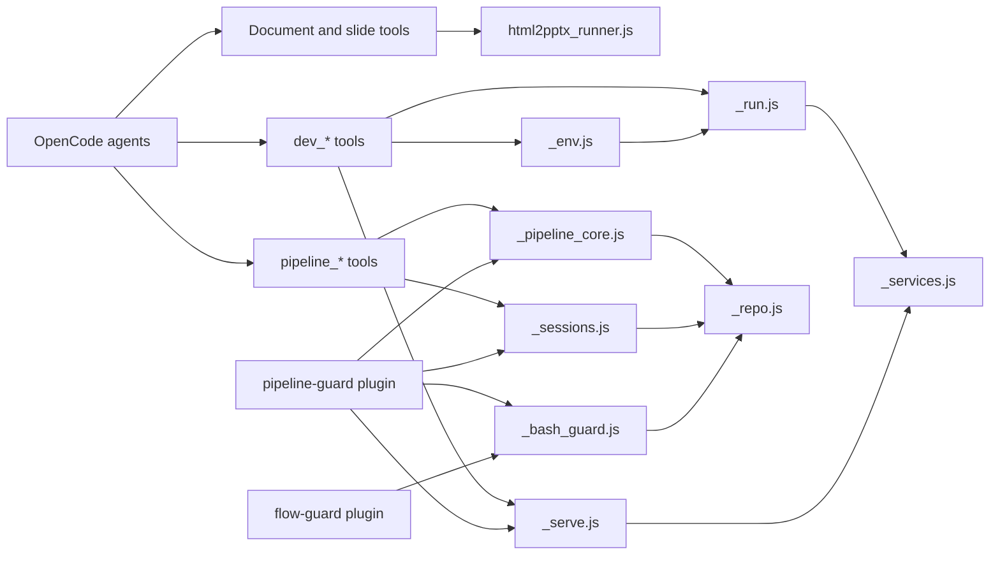

# Tools and Plugins

## Purpose

This module provides OpenCode custom tools for creating and converting documents, authoring slide decks, and running controlled repository workflows. In V2 the tools are plugin-provided: `tools/*.ts` is not auto-discovered, and each `src/plugins/<name>/index.ts` directory registers its tools through `ctx.tool.transform`. The `pipeline-guard` plugin adds session-scoped safety checks, an activity log, and bookkeeping for pipeline agents; its checks complement, rather than replace, agent permissions.

## Key Files

| File | Role |
|------|------|
| `src/tools/doc_create.ts`, `doc_view.ts`, `doc_modify.ts`, `doc_convert.ts` | Create, inspect, edit, and export the canonical HTML document source. |
| `src/tools/doc_compile_theme.ts` | Resolves document design tokens, compiles theme CSS, and copies local fonts. |
| `src/tools/slide_compile_theme.ts`, `slide_compile_composition.ts` | Prepare slide theme and composition assets. |
| `src/tools/slide_build_pptx.ts`, `slide_assemble_pptx.ts` | Convert HTML slides to editable PPTX (`slide_build_pptx` runs `html2pptx_runner.js`) or populate a corporate template. |
| `src/tools/pptx/html2pptx_runner.js`, `src/tools/pptx/html2pptx.js` | Node CLI that loads `pptxgenjs` and converts each HTML slide into positioned slide elements; invoked by `slide_build_pptx`. |
| `src/tools/_repo.js`, `_sessions.js`, `_bash_guard.js` | Shared helpers without a workflow prefix: repository paths, git, scratch, snapshots and locking (`_repo.js`); the session registry (`_sessions.js`); the bash tokenizer and write/git checks used by both `pipeline-guard` and `flow-guard` (`_bash_guard.js`, messages prefixed `Guard:`). |
| `src/tools/_pipeline_core.js` | Pipeline-only logic: agent and role matching, activity log, stale-session cleanup, file claims, and commit planning. |
| `src/tools/dev_env.ts`, `src/tools/_env.js` | `dev_env` tool and its read-only, bounded (~5 s) Phase 0 probe: Docker, database/runtime binaries, `.opencode/pipeline.json`, MCP server names, `.env.example` variable presence, and a derived `verification_outlook`. Never returns values. |
| `src/tools/_run.js`, `_serve.js` | Bounded verification/smoke execution and controlled development-service lifecycle. |
| `src/tools/_services.js` | Dependent services for verify/smoke runs (custom services and PostgreSQL, native or Docker) and the `sh` supervisor shared with `_serve.js`. |
| `src/plugins/pipeline-guard/index.ts` | V2 plugin directory (`Plugin.define`, id `pipeline-guard`). Its hooks set the scratch environment, guard writes and git commands, reject doom loops, record touched files, write the per-root activity log, stop the services a session owns on idle, and warn about git-state anomalies. It is the only form of the guard: the legacy single-file `plugins/pipeline-guard.js` is not in `src/plugins/`. |
| `src/plugins/dev-tools/index.ts`, `src/plugins/pipeline-tools/index.ts`, `src/plugins/doc-tools/index.ts`, `src/plugins/slide-tools/index.ts` | Register the shared development tools (`dev_*`, used by `pipeline` and `flow`), the pipeline-only tools, and the document and slide tools through `ctx.tool.transform`. |
| `src/plugins/README.md` | Documents plugin installation, its enforcement contract, and `.opencode/pipeline.json`. |

## Public API

The TypeScript tool modules keep the `tool({ description, args, execute })` definitions and live under `src/tools/`, but V2 does not scan that directory. Each plugin directory imports its registry statically and registers the tools with `ctx.tool.transform`; the effective tool name is `<namespace>_<name>` (verified at runtime: `pipeline_state`), so `dev-tools` uses the `dev` namespace, `pipeline-tools` uses `pipeline`, `doc-tools` uses `doc`, and `slide-tools` uses `slide`. A component used by more than one workflow carries no workflow prefix. Their contracts and lifecycle hooks are detailed in the [OpenCode Tools and Plugin Hooks API reference](../api/opencode-tools-and-plugin.md).

| Workflow | Tools |
|----------|-------|
| Documents | `doc_compile_theme`, `doc_create`, `doc_view`, `doc_modify`, `doc_list`, `doc_convert`, `doc_restore` |
| Slides | `slide_analyze_template`, `slide_assemble_pptx`, `slide_build_pptx`, `slide_compile_composition`, `slide_compile_theme`, `slide_create_thumbnails`, `slide_download_image`, `slide_generate_image`, `slide_screenshot` |
| Development (pipeline and flow) | `dev_env`, `dev_verify`, `dev_smoke`, `dev_serve` |
| Pipeline only | `pipeline_state`, `pipeline_commit` |
| Plugin | `setupPipelineGuard` creates the hooks; the default export is a `Plugin.define` descriptor for plugin id `pipeline-guard`. |

The document tools use safe project/document path segments and delegate document operations to Python scripts under the OpenCode `docx/scripts` directory. Theme compilers produce `_theme.css`; slide builds write versioned PPTX outputs. Pipeline tools return structured JSON, with verification and service operations bounded by configured timeouts and lifecycle handling.

`dev_env` is the Phase 0 probe: it takes an optional `workspace` (repo-relative sub-project) and never modifies anything. The `docker info` call is capped at 3 s and the whole probe is raced against a budget of about 4.5 s. It reads the MCP server names, types, and enabled flags from the opencode config files, never their commands, URLs, or headers. It checks `.env.example` / `.env.sample` for variable names and reports only whether each is set; `.env` itself is not read.

### V2 lifecycle hooks

The guard registers OpenCode V2 hooks; the V1 hook names no longer exist. The replacement mapping is:

| V1 hook | V2 hook |
|---------|---------|
| `chat.params` | `session.hook("model.request")` |
| `chat.message` | `session.hook("prompt")` |
| `experimental.session.compacting` | `session.hook("compaction")` |
| `shell.env` | `shell.hook("create.before")` |
| `tool.execute.before` / `tool.execute.after` | `tool.hook("execute.before")` / `tool.hook("execute.after")` |
| `permission.ask` | `permission.hook("evaluate")` |
| `event` | `ctx.event.subscribe()` |

## Pipeline guard

`setupPipelineGuard` acts only on sessions whose agent name matches `pipeline-*` or `*-pipeline-*`; every other session is untouched. Beyond the path, shell, and file-claim checks, it adds:

- **Doom-loop guard**: V2 has no `doom_loop` permission action, so the guard rejects the third consecutive identical tool call in a session. Calls are compared as `(tool, stable input)` signatures with object keys sorted at every level. A different call, an idle session, or a session end resets the streak. The state is in-memory only.
- **Activity log**: one JSON line per event goes to `<git-common-dir>/opencode-pipeline/logs/<rootId>.jsonl`, shared by a root session and its subagents. Events are `tool`, `guard_block`, `permission`, `steps` (per-session LLM and tool-call counts, written on idle and at process exit), `session_error`, and `warning`. The file is capped at 512 KB; when full, the oldest half is dropped and a `truncated` marker records how many events were removed. `pipeline_state` reads the log back as `activity`.
- **Idle handling**: when a root session goes idle, the guard stops the service that session started with `dev_serve` (`stopServicesOwnedBy` from `_serve.js`), compares git state with the session baseline, and warns about new branches, worktrees, stashes, or a changed checked-out branch.

## Dependencies



Tools are invoked by agents; document and slide operations use their respective project assets and runners (`slide_build_pptx` spawns `html2pptx_runner.js`). The `dev_*` and `pipeline_*` tools and the guards share repository logic from `_repo.js` and the session registry from `_sessions.js`; `pipeline-guard` and `flow-guard` share the bash and path checks of `_bash_guard.js`, while `_pipeline_core.js` keeps only pipeline-specific logic. `_env.js` reuses the contract and autodetect helpers from `_run.js`, and `_serve.js` imports the `sh` supervisor from `_services.js`, which `_run.js` also uses for dependent services.

## Usage Example

`dev_verify` resolves the current repository and delegates the requested checks to the shared runner:

```ts
const info = repoInfo(context.directory || context.worktree)
if (!info) return JSON.stringify({ status: "error", error: "not a git repository" })
const result = await runVerify({
  info,
  checks: args.checks,
  files: args.files || [],
  filter: args.filter,
  workspace: args.workspace,
  withServices: args.with_services || [],
  stopOnFail: !args.continue_on_fail,
  signal: context.abort,
  owner: context.sessionID,
})
return JSON.stringify(result, null, 2)
```

This excerpt is the execution path in `src/tools/dev_verify.ts`; missing configured checks are reported as skipped by the tool contract, not as passed. `with_services` names are started by the shared service runner in `_services.js`, and they are always stopped when the run ends.
