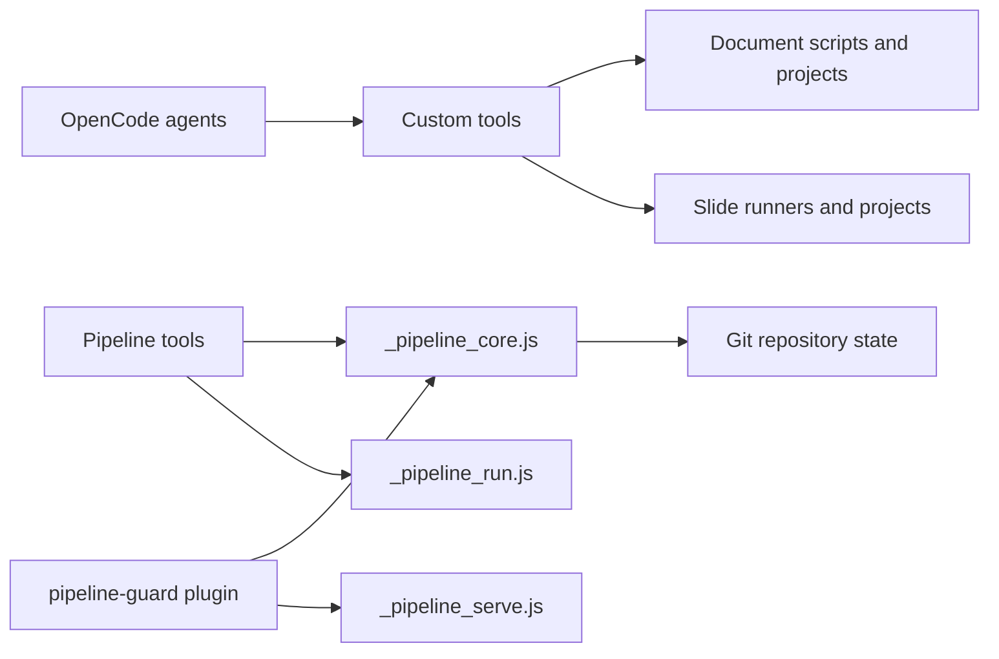

# Tools and Plugins

## Purpose

This module provides OpenCode custom tools for creating and converting documents, authoring slide decks, and running controlled repository workflows. The `pipeline-guard` plugin adds session-scoped safety checks and bookkeeping for pipeline agents; its checks complement, rather than replace, agent permissions.

## Key Files

| File | Role |
|------|------|
| `src/tools/doc_create.ts`, `doc_view.ts`, `doc_modify.ts`, `doc_convert.ts` | Create, inspect, edit, and export the canonical HTML document source. |
| `src/tools/doc_compile_theme.ts` | Resolves document design tokens, compiles theme CSS, and copies local fonts. |
| `src/tools/slide_compile_theme.ts`, `slide_compile_composition.ts` | Prepare slide theme and composition assets. |
| `src/tools/slide_build_pptx.ts`, `slide_assemble_pptx.ts` | Convert HTML slides to editable PPTX or populate a corporate template. |
| `src/tools/_pipeline_core.js` | Shared repository, session, path-guard, shell-check, locking, and commit-planning logic. |
| `src/tools/_pipeline_run.js`, `_pipeline_serve.js` | Bounded verification/smoke execution and controlled development-service lifecycle. |
| `src/plugins/pipeline-guard.js` | Hooks pipeline sessions to set scratch environment, guard writes, record touched files, and clean up services. |
| `src/plugins/README.md` | Documents plugin installation, its enforcement contract, and `.opencode/pipeline.json`. |

## Public API

The TypeScript tool modules register callable OpenCode tools using `tool({ description, args, execute })`; their contracts and lifecycle hooks are detailed in the [OpenCode Tools and Plugin Hooks API reference](../api/opencode-tools-and-plugin.md).

| Workflow | Tools |
|----------|-------|
| Documents | `doc_compile_theme`, `doc_create`, `doc_view`, `doc_modify`, `doc_list`, `doc_convert`, `doc_restore` |
| Slides | `slide_analyze_template`, `slide_assemble_pptx`, `slide_build_pptx`, `slide_compile_composition`, `slide_compile_theme`, `slide_create_thumbnails`, `slide_download_image`, `slide_generate_image`, `slide_screenshot` |
| Pipeline | `pipeline_state`, `pipeline_verify`, `pipeline_smoke`, `pipeline_serve`, `pipeline_commit` |
| Plugin | `createPipelineGuard` creates the hooks; the default export registers plugin id `pipeline-guard`. |

The document tools use safe project/document path segments and delegate document operations to Python scripts under the OpenCode `docx/scripts` directory. Theme compilers produce `_theme.css`; slide builds write versioned PPTX outputs. Pipeline tools return structured JSON, with verification and service operations bounded by configured timeouts and lifecycle handling.

## Dependencies



Tools are invoked by agents; document and slide operations use their respective project assets/runners, while pipeline tools and the plugin share repository/session logic.

## Usage Example

`pipeline_verify` resolves the current repository and delegates the requested checks to the shared runner:

```ts
const info = repoInfo(context.directory || context.worktree)
if (!info) return JSON.stringify({ status: "error", error: "not a git repository" })
const result = await runVerify({
  info,
  checks: args.checks,
  files: args.files || [],
  stopOnFail: !args.continue_on_fail,
  signal: context.abort,
  owner: context.sessionID,
})
return JSON.stringify(result, null, 2)
```

This excerpt is the execution path in `src/tools/pipeline_verify.ts`; missing configured checks are reported as skipped by the tool contract, not as passed.
