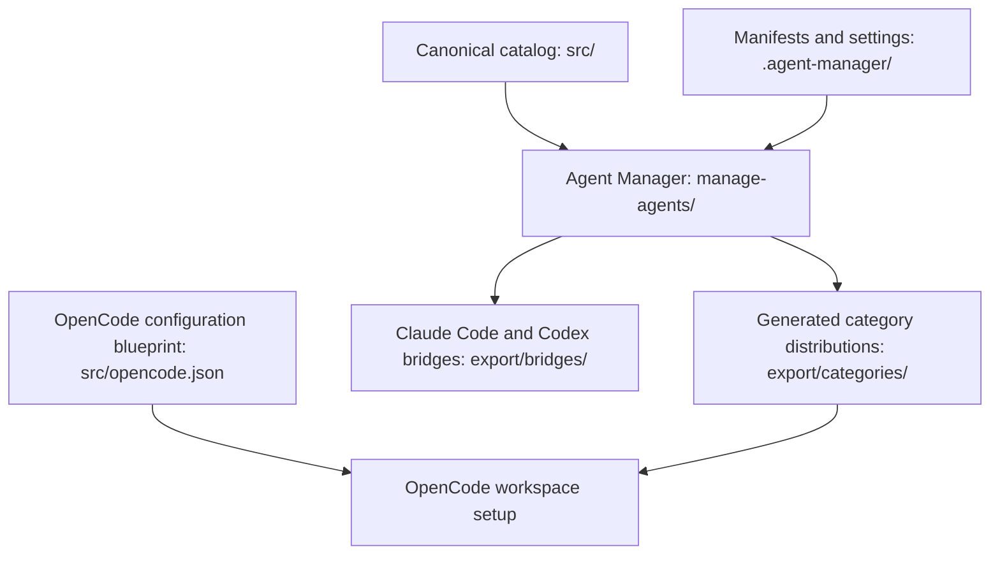

# OpenCode Agents Monorepo

This repository provides a reusable OpenCode workspace: canonical agent prompts and supporting resources, generated category distributions and Claude Code/Codex bridges, and a standalone terminal manager. Its main workflow is to maintain canonical content in `src/`, configure distributions in `.agent-manager/`, and use the manager to generate or validate outputs under `export/`; see [Architecture](./architecture.md) for the layers and flows, or [Getting Started](./getting-started.md) to run the manager.

## Key Features

- Agent prompt families for general pipeline work, documentation, slides, and wiki authoring, alongside commands, skills, tools, plugins, and an OpenCode configuration blueprint. The [agent catalog](./modules/agent-catalog.md) and [workflow resources](./modules/workflow-resources.md) describe these authored inputs.
- Manifest-driven category builds and checks, with generated category bundles kept separate from canonical input.
- Pipeline model profiles and bridge generation for Claude Code and Codex.
- A Node.js/Bun terminal CLI and interactive TUI for catalog maintenance and export workflows, documented in [Agent Manager](./modules/agent-manager.md).

## Tech Stack

| Layer | Technology |
|-------|-----------|
| Canonical resources | Markdown prompts, JSON manifests/configuration, and supporting tools |
| Manager | TypeScript, Node.js or Bun, React, and OpenTUI |
| Distribution | Generated files and configuration under `export/` |
| Package tooling | npm or Bun; package scripts use esbuild and TypeScript |

## System Overview



The manager reads canonical resources and configuration to create or validate generated distributions; the catalog also supplies the configuration blueprint for an OpenCode setup.

## Project Structure

```text
src/                         Canonical agent prompts and supporting resources
  agents/                    Pipeline, docs, slides, wiki, and other agent prompts
  commands/ skills/ tools/   Reusable workflow instructions and tools
  plugins/                   OpenCode plugins
  opencode.json              OpenCode configuration blueprint
.agent-manager/              Category manifests, pipeline profiles, and bridge settings
export/                      Generated category distributions and bridges
manage-agents/               TypeScript CLI and interactive terminal UI
```

The repository's [workspace and distribution configuration](./config/workspace-and-distribution.md) defines settings and bundle manifests, while the [custom tools and plugins](./modules/tools-and-plugins.md) provide document, slide, and pipeline capabilities. Edit source resources in `src/` and declarative configuration in `.agent-manager/`; generated outputs belong in `export/` and should be regenerated rather than edited directly.
