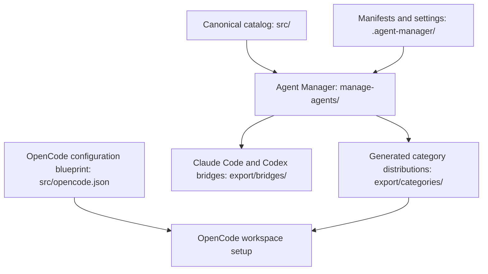

# OpenCode Agents Monorepo

This repository provides a reusable OpenCode workspace: canonical agent prompts and supporting resources, generated category distributions and Claude Code/Codex bridges, and a standalone terminal manager. Its main workflow is to maintain canonical content in `src/`, configure distributions in `.agent-manager/`, and use the manager to generate or validate outputs under `export/`; see [Architecture](./architecture.md) for the layers and flows, or [Getting Started](./getting-started.md) to run the manager.

## Key Features

- Agent prompt families for general pipeline work, documentation, slides, and wiki authoring, alongside commands, skills, tools, plugins, and an OpenCode configuration blueprint. The [agent catalog](./modules/agent-catalog.md) and [workflow resources](./modules/workflow-resources.md) describe these authored inputs.
- Manifest-driven category builds and checks, with generated category bundles kept separate from canonical input.
- Archetype model configurations for the `flow` and `pipeline` families (`.agent-manager/agent-routing.json`, applied at runtime by the `agent-router` plugin; see `ARCHETIPI.md`) and bridge generation for Claude Code and Codex. Both bridges emit a `decent-pipeline` plugin package under `export/bridges/{claude-code,codex}/decent-pipeline/` (plugin manifest, agents or skills, MCP config, and a README); TypeScript runtime plugins are not transpiled into the bridges. See [Agent Manager](./modules/agent-manager.md) for the generation commands.
- Shared pipeline components are versioned and synced to other repositories with `.agent-manager/shared-sync.json`, which declares component SemVer requirements and protected local overlays.
- Deterministic pipeline support in `src/plugins/`: `dev-tools` registers the `dev_*` tools shared with `flow` (`dev_env`, `dev_verify`, `dev_smoke`, `dev_serve`), `pipeline-tools` registers the pipeline-only `pipeline_state` and `pipeline_commit`, and `pipeline-guard` enforces write and git guards, rejects a third consecutive identical tool call (doom-loop guard), and appends a JSONL activity log per root session. See [Tools and plugins](./modules/tools-and-plugins.md).
- A Node.js/Bun terminal CLI and interactive TUI for catalog maintenance and export workflows, documented in [Agent Manager](./modules/agent-manager.md).

## Tech Stack

| Layer | Technology |
|-------|-----------|
| Canonical resources | Markdown prompts, JSON manifests/configuration, and supporting tools |
| Manager | TypeScript, Node.js or Bun, React, and OpenTUI |
| Distribution | Generated files and configuration under `export/` |
| Package tooling | npm or Bun; package scripts use esbuild and TypeScript |

## System Overview



The manager reads canonical resources and configuration to create or validate generated distributions; the catalog also supplies the configuration blueprint for an OpenCode setup.

## Project Structure

```text
src/                         Canonical agent prompts and supporting resources
  agents/                    Pipeline, docs, slides, wiki, and other agent prompts
  commands/ skills/ tools/   Reusable workflow instructions and tools
  plugins/                   OpenCode plugins
  opencode.json              OpenCode configuration blueprint
.agent-manager/              Category manifests, model configurations, and bridge settings
export/                      Generated category distributions and bridges
  categories/                docs, flow, general, pipeline, slides, and wiki bundles
  bridges/                   Claude Code and Codex packages (decent-pipeline)
manage-agents/               TypeScript CLI and interactive terminal UI
```

The `.agent-manager/` directory holds declarative configuration:

| File | Role |
|------|------|
| `categories/{docs,flow,pipeline,slides,wiki}.json` | Manifest V2 allowlists of resources per category, with SHA-256 provenance |
| `companion-links.json` | Companion plugin, command, skill, and tool links for category exports |
| `agent-routing.json` | Model configurations of the `flow` and `pipeline` archetypes, resolved into `src/plugins/agent-router/routing.json` |
| `translation-config.json` | Bridge settings: target, plugin name (`decent-pipeline`), prefix, model tiers, and role-to-tier mapping |
| `bash-profiles.json` | Bash permission profiles, synced with `pipeline sync-bash` |
| `shared-sync.json` | Shared component versions, include and exclude globs, and protected local overlays |

The `export/categories/` directory currently contains `docs`, `flow`, `general`, `pipeline`, `slides`, and `wiki`. The per-provider `*-pipeline` bundles were replaced by the single `pipeline` bundle plus model configurations.

The repository's [workspace and distribution configuration](./config/workspace-and-distribution.md) defines settings and bundle manifests, while the [custom tools and plugins](./modules/tools-and-plugins.md) provide document, slide, and pipeline capabilities. Edit source resources in `src/` and declarative configuration in `.agent-manager/`; generated outputs belong in `export/` and should be regenerated rather than edited directly.

## Related pages

- [Architecture](./architecture.md): layers, component diagram, and data flows
- [Getting Started](./getting-started.md): running the manager and exporting agents
- [Agent Manager](./modules/agent-manager.md): CLI and TUI commands, including bridge and sync
- [Agent catalog](./modules/agent-catalog.md) and [Workflow resources](./modules/workflow-resources.md): authored inputs under `src/`
- [Tools and plugins](./modules/tools-and-plugins.md) and [OpenCode tools and plugin API](./api/opencode-tools-and-plugin.md)
- [Workspace and distribution configuration](./config/workspace-and-distribution.md)
- [Glossary](./glossary.md)
